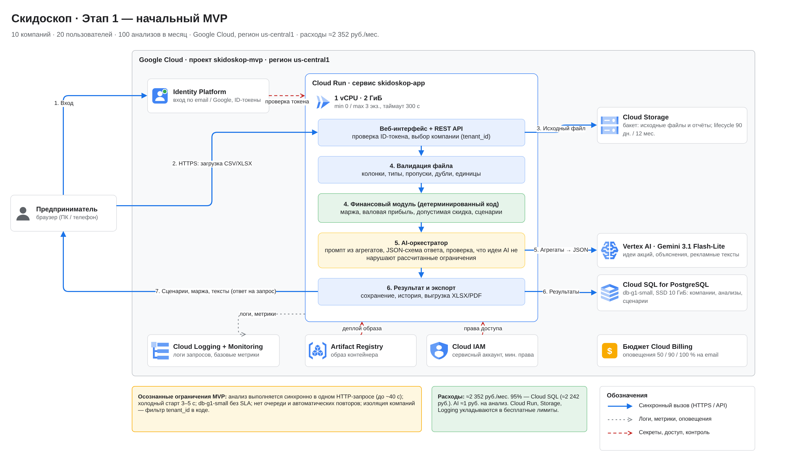
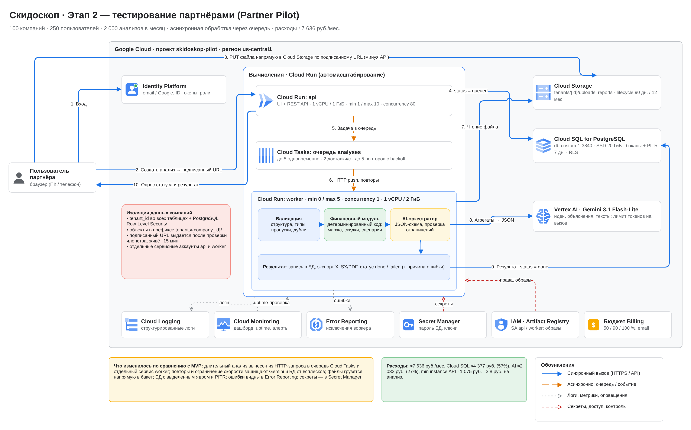
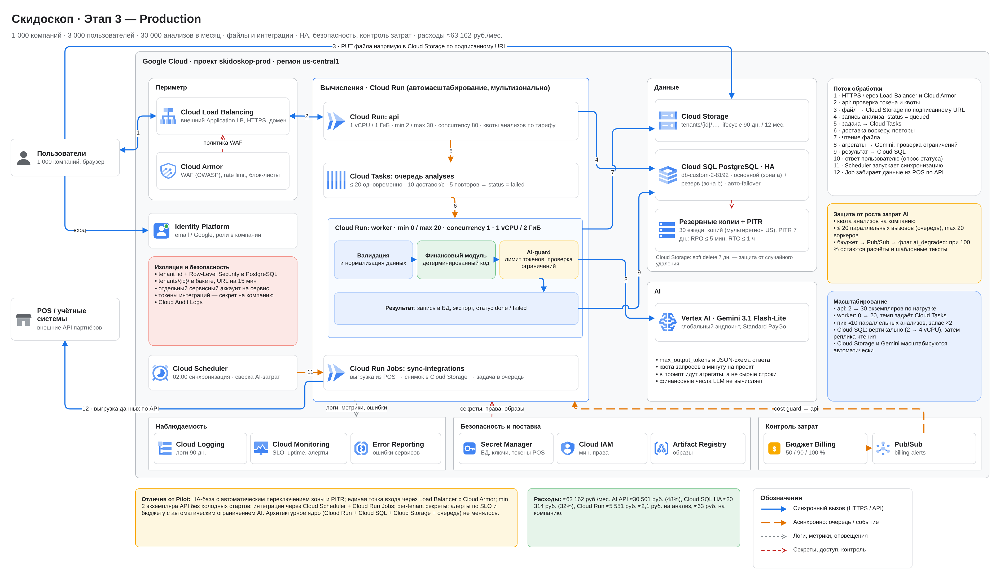

University: [ITMO University](https://itmo.ru/ru/)  
Faculty: [FICT](https://fict.itmo.ru)  
Course: Облачные платформы как основа технологического предпринимательства 
Year: 2026/2027  
Group: U4225  
Author: Davidyan Milana Eduardovnа  
Lab: Lab4
Date of create: 06.11.2026  
Date of finished: 

# Лабораторная работа №4 «Разработка инфраструктуры MVP AI-приложения»

**Материалы работы**

| Файл | Содержание |
|---|---|
| [`diagrams/skidoskop_mvp.drawio`](diagrams/skidoskop_mvp.drawio) | Схема этапа 1 — MVP (редактируемая, draw.io) |
| [`diagrams/skidoskop_pilot.drawio`](diagrams/skidoskop_pilot.drawio) | Схема этапа 2 — тестирование партнёрами |
| [`diagrams/skidoskop_production.drawio`](diagrams/skidoskop_production.drawio) | Схема этапа 3 — Production |
| [`calculations/skidoskop_cost_model.xlsx`](calculations/skidoskop_cost_model.xlsx) | Экономическая модель с формулами (допущения, тарифы, три стадии, сводка и сценарии) |

---

## 1. Цель лабораторной работы

Спроектировать облачную инфраструктуру AI-приложения для трёх состояний — начального MVP, тестирования партнёрами и Production, — рассчитать ежемесячные расходы на её содержание и обосновать выбор сервисов с учётом нагрузки и дальнейшего масштабирования.

## 2. Описание AI-приложения «Скидоскоп»

**Скидоскоп (Skidoskop)** — облачное AI-приложение для малого бизнеса, которое помогает планировать экономически обоснованные скидки и маркетинговые акции.

**Для кого.** Кофейни, пекарни, небольшие продуктовые магазины, локальные розничные сети, магазины одежды. У таких компаний обычно нет маркетолога и аналитика, поэтому скидки назначаются «на глаз».

**Проблема.** Скидка увеличивает число покупок, но может «съесть» валовую прибыль. Владелец редко заранее считает, сколько дополнительных продаж нужно, чтобы акция окупилась.

**Решение.** Пользователь загружает выгрузки продаж, цен, себестоимости и остатков (CSV/XLSX). Скидоскоп:

1. проверяет файлы и приводит их к единому формату;
2. **детерминированным кодом** считает маржинальность, валовую прибыль, оборачиваемость и максимально допустимую скидку для каждого товара;
3. просит языковую модель предложить механики акций (скидка на категорию, комплект «кофе + десерт», «счастливые часы»), объяснить результаты и написать рекламные тексты;
4. проверяет, что предложения модели не выходят за рассчитанные ограничения, и пересчитывает каждую механику кодом;
5. показывает сценарии с маржой, точкой безубыточности по объёму продаж, ограничениями и рисками.

**Принцип «LLM не считает деньги».** Цены, себестоимость, маржа, допустимые скидки и сценарные результаты считает только программный модуль. Модель получает уже рассчитанные агрегаты и отвечает по строгой JSON-схеме; все числа в её ответе перепроверяются кодом, а при нарушении ограничения ответ отклоняется и запрашивается заново (в модели затрат это учтено коэффициентом повторов 1,1). Если достоверных данных о реакции спроса на скидку нет, рост продаж показывается как **сценарий** («акция окупится, если продажи вырастут не менее чем на N %»), а не как прогноз.

**Проверка названия.** Веб-поиск 06.11.2026 по запросам «Скидоскоп» и «Skidoskop» не выявил заметных одноимённых сервисов или приложений (в выдаче — агрегаторы скидок с другими названиями). Это не является подтверждением юридической уникальности названия: перед запуском нужна проверка по реестру товарных знаков.

## 3. Основные функции и проектные допущения

### 3.1. Функции

| № | Функция | Где реализована |
|---|---|---|
| 1 | Регистрация и вход | Identity Platform (email, вход через Google) |
| 2 | Профиль компании, приглашение сотрудников | API + Cloud SQL |
| 3 | Загрузка CSV/XLSX: продажи, цены, себестоимость, остатки | Подписанные URL → Cloud Storage (с этапа Pilot) |
| 4 | Проверка структуры и качества данных | Модуль валидации |
| 5 | Хранение истории анализов | Cloud SQL + Cloud Storage |
| 6 | Расчёт маржи, валовой прибыли, ограничений скидок | Финансовый модуль (детерминированный) |
| 7 | Несколько сценариев акций | Финансовый модуль + AI-идеи |
| 8 | Генерация и объяснение рекомендаций | Gemini 3.1 Flash-Lite |
| 9 | Рекламные тексты | Gemini 3.1 Flash-Lite |
| 10 | Сравнение вариантов акций | API + интерфейс |
| 11 | Выгрузка результатов (XLSX/PDF) | Модуль экспорта → Cloud Storage |
| 12 | История рекомендаций | Cloud SQL |

### 3.2. Обработка данных

**Пользователь → загрузка файла → валидация → аналитический модуль → AI-рекомендации → проверка ограничений → сохранение результата → интерфейс пользователя.**

На MVP вся цепочка выполняется внутри одного HTTP-запроса. С этапа Pilot она разделена: API принимает запрос и ставит задачу в очередь, а длительную обработку выполняет отдельный воркер.

### 3.3. Нагрузка (задана заданием)

| Показатель | MVP | Pilot | Production |
|---|---:|---:|---:|
| Компаний | 10 | 100 | 1 000 |
| Пользователей | 20 | 250 | 3 000 |
| Анализов в месяц | 100 | 2 000 | 30 000 |
| Загрузка данных | CSV/XLSX | CSV/XLSX | файлы и интеграции |
| Надёжность | базовая | повышенная | production-grade |

### 3.4. Дополнительные допущения

Все значения — учебные допущения. Они вынесены на лист «Допущения» Excel-модели и редактируются (синие ячейки).

| Параметр | Значение | Обоснование |
|---|---|---|
| Файлов на анализ | 2 | продажи + справочник (цены, себестоимость, остатки) |
| Средний размер файла | 1,5 МБ | 20–40 тыс. строк продаж за 3 месяца |
| Производные данные и отчёт на анализ | 1 МБ | нормализованный снимок + выгрузка XLSX/PDF |
| Хранение исходных файлов / отчётов | 3 / 12 мес. | lifecycle-правила Cloud Storage |
| Объём в Cloud Storage (установившийся) | 2 / 41 / 615 ГиБ | анализы × (3 МБ × 3 мес. + 1 МБ × 12 мес.) |
| Вызовов LLM на анализ | 3 | идеи, объяснение, рекламные тексты |
| Входных / выходных токенов на анализ | 13 000 / 4 800 | в промпт идут агрегаты по товарам, а не сырые строки; выход включает «рассуждения» модели |
| Перегенерации текстов | 0,5 на анализ (2 000 / 800 токенов) | пользователь иногда просит другие варианты |
| Повторы вызовов LLM | ×1,1 | ответ не прошёл JSON-схему или проверку ограничений |
| Итого токенов на анализ | 15 400 вход / 5 720 выход | с перегенерациями и повторами |
| Время обработки анализа | 40 с | разбор ≈5 с, расчёты ≈3 с, LLM ≈25–30 с |
| Ресурсы обработчика | 1 vCPU, 2 ГиБ | разбор XLSX библиотеками pandas/openpyxl |
| API-запросов | 300 на пользователя + 60 на анализ в месяц | навигация, опрос статуса, просмотр, экспорт |
| Оплачиваемое время на API-запрос | 0,15 с | с учётом конкурентной обработки запросов |
| Трафик к пользователю | 15 сессий × 1,5 МБ + 1 МБ на анализ | интерфейс кэшируется браузером |
| Одновременных пользователей в пике | 3 / 25 / 60 | ≈20 % DAU, из них 10 % одновременно |
| Пиковая нагрузка анализов | 1 / 3 / 10 параллельно | Prod: 30 000 / 30 дн. × 2 (пиковый день) × 15 % в пиковый час, по 40 с, запас ×3 |
| Частота отчётов | 1 выгрузка на анализ | в среднем |
| Интеграции (Prod) | 30 % компаний, 1 синхронизация в сутки по 60 с | Cloud Run Jobs |
| Логи | 1,5 КБ на запрос (3 КБ в Prod с журналом LB), 100 КБ на анализ | структурированные логи |

## 4. Архитектура начального MVP

Редактируемый файл: [`diagrams/skidoskop_mvp.drawio`](diagrams/skidoskop_mvp.drawio).

**Идея этапа:** все функции работают, но с минимумом движущихся частей — один контейнер, одна база, одно хранилище.

| Компонент | Конфигурация | Роль |
|---|---|---|
| Cloud Run `skidoskop-app` | 1 vCPU, 2 ГиБ, min 0 / max 3, таймаут 300 с | веб-интерфейс, API, валидация, финансовый модуль, AI-оркестратор, экспорт |
| Identity Platform | email + Google | регистрация, вход, ID-токены |
| Cloud Storage | бакет Standard, us-central1, lifecycle 90 дн. / 12 мес. | исходные файлы и отчёты |
| Cloud SQL for PostgreSQL | db-g1-small (shared-core), SSD 10 ГиБ, ежедневные копии | компании, пользователи, анализы, сценарии |
| Vertex AI, Gemini 3.1 Flash-Lite | глобальный эндпоинт | идеи, объяснения, тексты |
| Cloud Logging + Monitoring | стандартные логи и метрики | базовая диагностика |
| Artifact Registry, Cloud IAM | 1 образ, сервисный аккаунт с минимальными правами | поставка и доступ |
| Бюджет Cloud Billing | оповещения 50/90/100 % | защита от неожиданного счёта |

**Как это работает.** Пользователь входит через Identity Platform (1), отправляет файл в API (2), файл сохраняется в Cloud Storage (3), затем в том же запросе выполняются валидация и расчёты (4), вызов Gemini (5), запись результата в Cloud SQL (6) и ответ пользователю (7).

**Осознанные ограничения:** анализ длится до ~40 с внутри одного HTTP-запроса; при min 0 возможен холодный старт 3–5 с; db-g1-small не покрывается SLA; нет очереди и автоматических повторов; изоляция компаний обеспечивается фильтром `tenant_id` в коде. Для 10 компаний и ~3 анализов в день это приемлемо.

## 5. Архитектура партнёрского пилота

Редактируемый файл: [`diagrams/skidoskop_pilot.drawio`](diagrams/skidoskop_pilot.drawio).

**Что меняется и почему:**

| Изменение | Зачем |
|---|---|
| Сервис разделён на `api` и `worker` | API отвечает за миллисекунды, тяжёлая обработка не блокирует интерфейс и масштабируется отдельно |
| **Cloud Tasks** — очередь `analyses` (≤5 одновременных доставок, 2/с, до 5 повторов с backoff) | асинхронность, автоматические повторы при сбоях Gemini, ограничение темпа вызовов LLM и нагрузки на БД |
| Загрузка файла напрямую в Cloud Storage по **подписанному URL** (15 мин) | файл не проходит через API: меньше памяти и времени Cloud Run, надёжнее для больших XLSX |
| Статус анализа в БД (`queued → running → done/failed`) + опрос статуса | пользователь видит прогресс и причину ошибки |
| Cloud SQL **db-custom-1-3840** (выделенное ядро), SSD 20 ГиБ, бэкапы + PITR 7 дней | производительность без «соседей» по ядру, восстановление на момент времени |
| **Изоляция компаний:** `tenant_id` + PostgreSQL Row-Level Security, префикс `tenants/{id}/` в бакете, отдельные сервисные аккаунты | данные партнёров не смешиваются даже при ошибке в коде запроса |
| **Secret Manager** | пароль БД и ключи не хранятся в переменных окружения и образе |
| **Error Reporting**, дашборд и uptime-проверка в Cloud Monitoring, алерты | ошибки партнёров видны раньше, чем партнёр напишет о них |
| API: min 1 / max 10; worker: min 0 / max 5, concurrency 1 | нет холодного старта для пользователей, воркеры добавляются автоматически при росте очереди |

Поток: вход (1) → создание анализа и получение подписанного URL (2) → загрузка файла напрямую в Cloud Storage (3) → запись `queued` (4) → задача в очередь (5) → доставка воркеру с повторами (6) → чтение файла (7) → Gemini (8) → результат и `done` (9) → опрос статуса и показ результата (10).

## 6. Архитектура Production

Редактируемый файл: [`diagrams/skidoskop_production.drawio`](diagrams/skidoskop_production.drawio).

| Требование | Решение |
|---|---|
| Автоматическое масштабирование | API min 2 / max 30 (concurrency 80); worker 0 → 20; темп задаёт Cloud Tasks (≤20 одновременно, 10/с); Cloud SQL масштабируется вертикально, затем реплика чтения |
| Надёжное хранение | Cloud SQL **HA** (основной экземпляр в зоне a, резерв в зоне b, автоматический failover); Cloud Storage с soft delete 7 дней |
| Восстановление данных | 30 ежедневных копий (по умолчанию хранятся в мультирегионе), PITR 7 дней: RPO ≤ 5 мин, RTO ≤ 1 ч |
| Изоляция компаний | RLS по `tenant_id`, префиксы бакета, подписанные URL, отдельные сервисные аккаунты, Cloud Audit Logs |
| Безопасность периметра | внешний Application Load Balancer + **Cloud Armor** (WAF OWASP, rate limit на `/auth` и `/api/analyses`, блок-листы) |
| Управление секретами | Secret Manager: системные секреты + отдельный секрет с OAuth-токеном интеграции каждой компании |
| Файлы и интеграции | Cloud Scheduler в 02:00 запускает **Cloud Run Jobs** `sync-integrations`: выгрузка из POS/учётных систем → снимок в Cloud Storage → задача анализа в очередь |
| Мониторинг и оповещения | Cloud Logging (90 дней), Cloud Monitoring (SLO, uptime, алерты), Error Reporting |
| Обработка сбоев | повторы Cloud Tasks с backoff, идемпотентные обработчики (ключ анализа), после 5 попыток — `failed` с причиной; failover БД; ≥2 экземпляра API |
| Контроль затрат AI | квота анализов на компанию по тарифу; `max_output_tokens` и JSON-схема; ограничение параллельности очередью; бюджет Billing → **Pub/Sub** → флаг `ai_degraded` в API (при 100 % бюджета остаются расчёты и шаблонные тексты) |

Архитектурное ядро — Cloud Run + Cloud SQL (PostgreSQL) + Cloud Storage + очередь Cloud Tasks — одинаково на этапах Pilot и Production. Переход между стадиями — это изменение конфигурации и добавление компонентов, а не переписывание приложения.

## 7. Экономическая модель

### 7.1. Методика

1. Тарифы взяты с официальных страниц Google Cloud **06.11.2026** (ссылки — в разделе 12 и на листе «Тарифы и курс»). Регион — **us-central1** (Айова, Tier 1 для Cloud Run). Для Gemini — Standard PayGo, глобальный эндпоинт.
2. Объём потребления каждого сервиса рассчитан формулами из допущений раздела 3.
3. Стоимость посчитана в **USD** — исходной валюте тарифов.
4. Перевод в рубли: **Расходы, руб. = Расходы, USD × 81,7947** — официальный курс USD/RUB, установленный Банком России на 06.11.2026 ([cbr.ru](https://www.cbr.ru/currency_base/daily/)).
5. Сервисы с постоянной оплатой (Cloud SQL, min instances, правило LB, политика Cloud Armor) посчитаны за полный месяц (730 ч).
6. Бесплатные лимиты (Free Tier) показаны **отдельными строками со знаком минус**. Промо-кредиты новых аккаунтов не учитывались.
7. Не входят в расчёт: зарплаты, разработка, маркетинг, домен и почтовый сервис, налоги/НДС и комиссии посредников, staging-окружение.

> **Ограничение.** Google Cloud с 2022 года не регистрирует новых клиентов из России, прямая оплата российской компанией недоступна. Рублёвая оценка — аналитическая модель затрат, а не подтверждение возможности купить эти услуги. Также учтён 152-ФЗ: персональные данные пользователей из РФ при реальном запуске должны первично храниться в России (см. раздел 10).

Все числа ниже совпадают с файлом [`skidoskop_cost_model.xlsx`](calculations/skidoskop_cost_model.xlsx); курс, нагрузка и токены редактируются, итоги пересчитываются формулами.

### 7.2. Используемые тарифы (основные)

| Сервис | Тариф, USD | Бесплатный лимит |
|---|---|---|
| Cloud Run, CPU / память (активное время) | 0,000024 за vCPU-с / 0,0000025 за ГиБ-с | 180 000 vCPU-с, 360 000 ГиБ-с |
| Cloud Run, простой min instances | 0,0000025 за vCPU-с и за ГиБ-с | — |
| Cloud Run, запросы | 0,40 за 1 млн | 2 млн |
| Cloud Run Jobs, CPU / память | 0,000018 / 0,000002 | 240 000 vCPU-с, 450 000 ГиБ-с |
| Gemini 3.1 Flash-Lite, вход / выход | 0,25 / 1,50 за 1 млн токенов | — |
| Cloud Storage Standard | 0,02 за ГиБ-мес.; класс A 0,005 / класс B 0,0004 за 1 000 оп. | 5 ГиБ, 5 000 A, 50 000 B (us-central1) |
| Cloud SQL db-g1-small | 0,035 за ч (HA 0,07) | — |
| Cloud SQL vCPU / память | 0,0413 за vCPU-ч / 0,007 за ГиБ-ч (HA ×2) | — |
| Cloud SQL SSD / копии | 0,17 (HA 0,34) / 0,08 за ГиБ-мес. | — |
| Cloud Tasks | 0,40 за 1 млн операций | 1 млн |
| Исходящий трафик Premium Tier (в Европу) | 0,12 за ГиБ | 1 ГиБ |
| Load Balancer: правила / данные | 0,025 за ч (до 5 правил) / 0,008 за ГиБ | — |
| Cloud Armor Standard | 5 за политику, 1 за правило, 0,75 за 1 млн запросов | — |
| Cloud Logging | 0,50 за ГиБ, 0,01 за ГиБ-мес. сверх 30 дн. | 50 ГиБ на проект |
| Secret Manager | 0,06 за версию-мес., 0,03 за 10 000 обращений | 6 версий, 10 000 обращений |
| Identity Platform | 0 до 50 000 MAU | 50 000 MAU |

### 7.3. Сводная таблица расходов

| Категория | MVP, руб./мес. | Pilot, руб./мес. | Production, руб./мес. |
|---|---:|---:|---:|
| Вычислительные ресурсы (Cloud Run, Artifact Registry) | 8 | 1 095 | 5 551 |
| Хранение файлов (Cloud Storage) | 0 | 65 | 1 149 |
| База данных (Cloud SQL) | 2 242 | 4 377 | 20 314 |
| AI API (Gemini) | 102 | 2 033 | 30 501 |
| Очереди и обработка задач (Tasks, Pub/Sub, Scheduler, Cloud Run Jobs) | 0 | 0 | 456 |
| Сетевые расходы (трафик, Load Balancer) | 0 | 65 | 2 510 |
| Мониторинг и безопасность (Logging, Monitoring, Secret Manager, Armor, Identity) | 0 | 0 | 2 680 |
| **Итого, руб./мес.** | **2 352** | **7 636** | **63 162** |
| Итого, USD/мес. | 28,75 | 93,35 | 772,20 |

*Нули означают, что потребление укладывается в бесплатный лимит; суммы по строкам могут отличаться от итога на 1 руб. из-за округления.*

### 7.4. Удельные показатели

| Показатель | MVP | Pilot | Production |
|---|---:|---:|---:|
| Стоимость одного анализа, руб. | 23,52 | 3,82 | 2,11 |
| Расходы на одну компанию, руб./мес. | 235,19 | 76,36 | 63,16 |
| Расходы на одного пользователя, руб./мес. | 117,60 | 30,54 | 21,05 |
| AI-стоимость одного анализа, руб. | 1,02 | 1,02 | 1,02 |
| Доля AI API в расходах | 4,3 % | 26,6 % | 48,3 % |
| Фиксированные расходы, руб./мес. | 2 237 | 5 407 | 25 364 |
| Переменные расходы, руб./мес. | 115 | 2 229 | 37 798 |
| Доля фиксированных расходов | 95,1 % | 70,8 % | 40,2 % |
| Экономия за счёт бесплатных лимитов, руб./мес. (уже учтена) | 70 | 3 697 | 9 483 |

**Фиксированные** — расходы, которые не зависят от числа анализов: Cloud SQL (экземпляр и диск), простой min instances Cloud Run, правило Load Balancer, политика и правила Cloud Armor, версии секретов, uptime-проверки. **Переменные** растут с нагрузкой: токены Gemini, активное время Cloud Run, объём Cloud Storage, трафик, логи.

### 7.5. Крупнейшие статьи Production

| Статья | руб./мес. |
|---|---:|
| Gemini — выходные токены (171,6 млн) | 21 054 |
| Gemini — входные токены (462 млн) | 9 447 |
| Cloud SQL HA — vCPU (2 vCPU × 730 ч) | 9 864 |
| Cloud SQL HA — память (8 ГиБ × 730 ч) | 6 688 |
| Cloud SQL HA — SSD 100 ГиБ | 2 781 |
| Cloud Run worker — CPU и память | 2 846 |
| Cloud Run API — простой 2 min instances | 2 150 |
| Secret Manager — 312 версий секретов | 1 531 |
| Load Balancer — правило переадресации | 1 493 |

### 7.6. Сценарии и чувствительность

**Рост числа анализов в 2 раза** (лист «Сводка и сценарии», столбцы «сценарий» на листах стадий):

| Показатель | MVP | Pilot | Production |
|---|---:|---:|---:|
| Итого при ×2 анализов, руб./мес. | 2 454 | 9 823 | 98 890 |
| Рост затрат | +4,3 % | +28,6 % | +56,6 % |
| Стоимость анализа, руб. | 12,27 | 2,46 | 1,65 |
| Предельная стоимость дополнительного анализа, руб. | 1,02 | 1,09 | 1,19 |

Удвоение нагрузки не удваивает расходы: фиксированная часть не растёт, а бесплатные лимиты на малых стадиях поглощают прирост. Предельная стоимость анализа ≈1–1,2 руб. — это почти целиком токены Gemini.

**Чувствительность к объёму токенов** (итого, руб./мес.):

| Токены | MVP | Pilot | Production |
|---|---:|---:|---:|
| ×0,5 | 2 301 | 6 619 | 47 911 |
| ×1 (база) | 2 352 | 7 636 | 63 162 |
| ×2 | 2 454 | 9 669 | 93 663 |
| ×3 | 2 555 | 11 702 | 124 165 |

**Чувствительность к курсу USD/RUB** (итого, руб./мес.):

| Курс | MVP | Pilot | Production |
|---|---:|---:|---:|
| 75,00 | 2 157 | 7 001 | 57 915 |
| 81,7947 (ЦБ, 06.11.2026) | 2 352 | 7 636 | 63 162 |
| 90,00 | 2 588 | 8 401 | 69 498 |
| 100,00 | 2 875 | 9 335 | 77 220 |

**Альтернативная модель.** Если заменить Gemini 3.1 Flash-Lite на более мощную Gemini 3.5 Flash (1,50 / 9,00 USD за 1 млн токенов), расходы на AI в Production вырастут с 30 501 до 183 007 руб./мес., а общий итог — до 215 668 руб./мес. (в 3,4 раза). Для задач Скидоскопа (структурированные идеи и тексты по готовым цифрам) лёгкой модели достаточно; более мощную модель имеет смысл подключать точечно (например, для платного тарифа), а не по умолчанию.

## 8. Сравнение трёх стадий

| Аспект | MVP | Pilot | Production |
|---|---|---|---|
| Обработка | синхронно в HTTP-запросе | асинхронно: Cloud Tasks → worker | асинхронно + ночные интеграции (Cloud Run Jobs) |
| Вычисления | 1 сервис Cloud Run, min 0 | api (min 1) + worker | api (min 2, max 30) + worker (max 20) + jobs |
| Загрузка файлов | через API | напрямую в Cloud Storage по подписанному URL | то же + интеграции с POS |
| База данных | db-g1-small, без SLA | 1 vCPU, PITR 7 дн. | 2 vCPU, 8 ГиБ, HA, 30 копий + PITR |
| Изоляция компаний | `tenant_id` в коде | + RLS, префиксы, отдельные SA | + секрет на компанию, аудит |
| Безопасность | IAM, Identity Platform | + Secret Manager | + Load Balancer, Cloud Armor |
| Мониторинг | стандартные логи, бюджет | + Error Reporting, дашборд, uptime, алерты | + SLO, логи 90 дн., бюджет → автоматическое ограничение AI |
| Расходы, руб./мес. | 2 352 | 7 636 | 63 162 |
| Стоимость анализа, руб. | 23,52 | 3,82 | 2,11 |

## 9. Обоснование выбора сервисов

### 9.1. Выбранные компоненты

| Компонент | Назначение и почему нужен | Стадии | Нагрузка и конфигурация | Масштабирование | Почему лучше альтернатив |
|---|---|---|---|---|---|
| **Cloud Run (services)** | веб-интерфейс, API, воркер анализа | все | MVP 1 сервис 1 vCPU / 2 ГиБ; Prod api 1 vCPU / 1 ГиБ ×(2–30), worker 1 vCPU / 2 ГиБ ×(0–20) | автоматически по запросам; лимит max instances ограничивает расходы | в отличие от Compute Engine/GKE нет постоянно оплачиваемых ВМ и администрирования кластера; оплата за время обработки, контейнер переносим |
| **Cloud Run Jobs** | ночная синхронизация интеграций | Prod | 300 компаний × 60 с в сутки | число задач в запуске | пакетная работа без HTTP-таймаутов, дешевле тариф instance-based |
| **Cloud Storage** | исходные файлы, снимки, отчёты | все | 2 → 41 → 615 ГиБ | без ограничений, lifecycle-удаление | объектное хранилище дешевле диска БД в ~8 раз (0,02 против 0,17 USD/ГиБ), подписанные URL снимают нагрузку с API |
| **Cloud SQL for PostgreSQL** | компании, пользователи, анализы, сценарии, история | все | g1-small → 1 vCPU → 2 vCPU HA | вертикально, затем реплика чтения | реляционные данные, транзакции, SQL-отчёты и сравнения, RLS для изоляции арендаторов (см. 9.2) |
| **Vertex AI · Gemini 3.1 Flash-Lite** | идеи акций, объяснения, тексты | все | 15 400 / 5 720 токенов на анализ | управляемый сервис, квоты проекта | GA с 08.05.2026, самый дешёвый стабильный вариант; не требует GPU; оплата за токены |
| **Identity Platform** | регистрация, вход, роли | все | до 3 000 пользователей | 0 руб. до 50 000 MAU | готовая аутентификация вместо собственной с хранением паролей |
| **Cloud Tasks** | очередь анализов | Pilot, Prod | 6 000 → 90 000 операций/мес. | лимиты параллельности и скорости | точечная доставка задач на HTTP-эндпоинт с повторами и ограничением темпа — то, что нужно для дорогих вызовов LLM |
| **Pub/Sub** | уведомления бюджета → cost guard | Prod | < 1 ГиБ/мес. | автоматически | именно так Cloud Billing отправляет программные уведомления о бюджете |
| **Cloud Scheduler** | запуск синхронизаций | Prod | 2 задания | — | управляемый cron, 3 задания бесплатно |
| **Secret Manager** | пароли, ключи, токены интеграций | Pilot, Prod | 4 → 312 версий | — | секреты отделены от кода и образа, доступ по IAM, аудит обращений |
| **Cloud IAM** | минимальные права сервисов | все | 1 → 3 сервисных аккаунта | — | встроенный механизм, бесплатно |
| **Cloud Logging / Monitoring / Error Reporting** | логи, метрики, алерты, ошибки | все (расширяется) | 0,5 → 14 ГиБ логов | — | укладывается в бесплатные 50 ГиБ, встроено в Cloud Run |
| **Cloud Load Balancing + Cloud Armor** | единая точка входа, WAF, rate limiting | Prod | 2,7 млн запросов/мес. | глобально | без балансировщика нельзя подключить Cloud Armor к Cloud Run; защита дорогого AI-эндпоинта от ботов окупает ≈2 700 руб./мес. |
| **Artifact Registry** | образы контейнеров | все | 1,5 → 9 ГиБ | — | хранилище образов в том же регионе, без платы за трафик |

**Сознательно не используются:** GKE и Compute Engine (избыточное администрирование при такой нагрузке), Memorystore (кэш не нужен: тяжёлых повторяющихся чтений нет), BigQuery (аналитика по 1 000 компаний помещается в PostgreSQL), Cloud CDN (интерфейс небольшой и кэшируется браузером), отдельная векторная БД (рекомендации строятся по табличным данным, а не по поиску документов).

### 9.2. Ключевые архитектурные решения

**Firestore против Cloud SQL.** Firestore на MVP почти бесплатен (бесплатная квота 50 000 чтений и 20 000 записей в день), а Cloud SQL стоит ≈2 242 руб./мес. — это 95 % бюджета MVP. Тем не менее выбран Cloud SQL (PostgreSQL), потому что данные Скидоскопа реляционные: компания → пользователи → загрузки → товары → анализы → сценарии. Нужны агрегирующие запросы (сравнение акций, история по категориям), транзакции и Row-Level Security для изоляции арендаторов. В Firestore это пришлось бы реализовывать вручную и денормализовать данные, а переход на SQL на этапе пилота означал бы миграцию данных и переписывание слоя доступа. Рост внутри Cloud SQL (g1-small → 1 vCPU → 2 vCPU HA) — это смена конфигурации экземпляра.

**Синхронная обработка против асинхронной.** На MVP синхронная обработка проще и допустима (≈3 анализа в день). На пилоте 40-секундный HTTP-запрос становится проблемой: сбой Gemini приводит к потере работы пользователя, нет повторов, а всплеск загрузок одновременно бьёт по LLM и БД. Очередь Cloud Tasks даёт повторы с backoff, ограничение параллельности (а значит, и мгновенных расходов на AI) и статус задачи. Cloud Tasks выбран вместо Pub/Sub, потому что нужна доставка конкретному обработчику с контролем темпа, а не рассылка событий многим подписчикам ([сравнение в документации Google](https://cloud.google.com/pubsub/docs/choosing-pubsub-or-cloud-tasks)).

**Serverless против постоянно запущенных ресурсов.** Нагрузка неравномерна: днём пики, ночью почти ноль. Cloud Run берёт плату за время обработки, и на MVP/Pilot активные вычисления полностью покрываются бесплатным лимитом. Постоянно включёнными оставлены только компоненты, где это оправдано: база данных (нужна всегда), min instances API на пилоте и в Production (холодный старт портит впечатление пользователей; цена — ≈1 075 руб. за экземпляр в месяц).

**Зональная база против HA.** HA удваивает стоимость vCPU, памяти и диска: в Production это ≈9 666 руб./мес. доплаты. Для 1 000 платящих компаний простой основной базы на время ремонта зоны (часы) дороже, поэтому HA включается только на Production.

## 10. Риски и ограничения

| Риск / ограничение | Влияние | Как снижается |
|---|---|---|
| Рост расходов на AI при всплеске нагрузки или «злоупотреблении» | AI — 48 % затрат Production; при ×3 токенов итог вырастает почти вдвое | квоты анализов на компанию, `max_output_tokens`, ограничение параллельности очередью, бюджет → Pub/Sub → режим `ai_degraded`, предупреждения на 50/90 % |
| Изменение тарифов и моделей | Gemini 3.x Flash по вводным ценам до 31.12.2026 подорожает с 01.01.2027 | выбрана модель с обычным тарифом; модель вынесена в конфигурацию, промпты покрыты тестами |
| Курс рубля | при 100 руб./USD Production стоит 77 220 руб. вместо 63 162 | цены тарифов для клиентов закладывать с запасом, пересматривать ежеквартально |
| Недоступность Google Cloud для российских компаний | прямой оплаты нет | для реального запуска — зарубежное юрлицо или эквивалентная архитектура у российского провайдера (Cloud Run ≈ serverless-контейнеры, Cloud SQL ≈ управляемый PostgreSQL) |
| 152-ФЗ (локализация персональных данных) | учётные записи пользователей — персональные данные | для пользователей из РФ первичное хранение ПДн в России; в Google Cloud — только обезличенные продажи |
| Задержка: регион us-central1 далеко от пользователей | +120–150 мс к запросу | для аналитического сервиса с асинхронной обработкой некритично; при реальном запуске выбрать европейский регион и пересчитать тарифы |
| Ошибки LLM (неверные цифры, «галлюцинации») | неправильные решения о скидках | LLM не считает деньги; все числа пересчитываются кодом; ответы проверяются по JSON-схеме и ограничениям |
| Нет данных об эластичности спроса | прогноз роста продаж может быть неверным | сценарный анализ «точка безубыточности по объёму», явные допущения в отчёте пользователю |
| Качество пользовательских файлов | ошибки разбора, неверные выводы | валидация структуры и единиц, отчёт об ошибках по строкам |
| Учебные допущения о нагрузке | реальные значения могут отличаться | все параметры вынесены в Excel и пересчитываются автоматически |

Схемы созданы программно в формате draw.io (XML `mxfile`) и отрисованы в PNG движком просмотра draw.io (`viewer-static.min.js` из открытого репозитория [jgraph/drawio](https://github.com/jgraph/drawio)). Иконки сервисов — из библиотеки Google Cloud Icons, встроенной в draw.io. Для Identity Platform, Secret Manager, пользователя и внешних систем в этой библиотеке нет отдельных иконок, поэтому использованы нейтральные пиктограммы с подписью сервиса.

## 11. Вывод

Спроектирована инфраструктура AI-приложения «Скидоскоп» для трёх стадий на одном архитектурном ядре: **Cloud Run + Cloud SQL (PostgreSQL) + Cloud Storage + Gemini**, к которому на пилоте добавляется очередь Cloud Tasks, а в Production — HA-база, Load Balancer с Cloud Armor, интеграции и автоматический контроль затрат.

Расходы составляют **≈2 352 руб./мес. на MVP, ≈7 636 руб./мес. на пилоте и ≈63 162 руб./мес. в Production** (курс ЦБ 81,7947 руб./USD на 06.11.2026). Стоимость анализа снижается с 23,52 до 2,11 руб., потому что фиксированные расходы распределяются на большую нагрузку. На MVP главная статья — база данных, в Production — AI API (48 %), поэтому основные рычаги экономии — длина промптов, выбор модели и квоты.

Самое дешёвое решение для MVP (Firestore, без базы данных) сэкономило бы около 2 240 руб. в месяц, но при переходе к пилоту потребовало бы миграции данных и переписывания приложения. Выбранный вариант дороже на старте, зато позволяет пройти все три стадии изменением конфигурации. Финансовые расчёты выполняет детерминированный код, а языковая модель отвечает только за идеи, объяснения и тексты, и её предложения проверяются по рассчитанным ограничениям.
